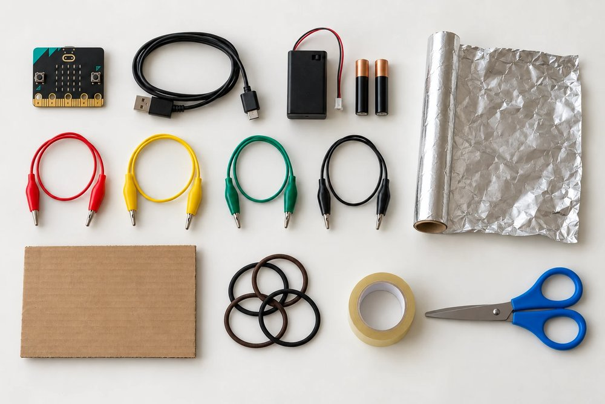

## What you will make

Can you remember the reboot code? Build a finger-controlled memory game, watch the micro:bit, then tap the code back to bring it to life.

> [!NOPRINT]
>
> <html>
> 

> <iframe style="position: absolute; top: 0; left: 0; right: 0; width: 100%; height: 100%; border: none;" src="https://www.youtube.com/embed/g3qdMucsHjQ?rel=0&cc_load_policy=1" allowfullscreen allow="accelerometer; autoplay; clipboard-write; encrypted-media; gyroscope; picture-in-picture; web-share">
> </iframe>
> 
 
> </html>

### You will need

- A BBC micro:bit V2
- A USB data cable
- A battery pack and two AAA batteries
- Four crocodile or alligator clip leads
- Kitchen foil
- Thin card, such as a cereal box or a piece of cardboard
- Three or four elastic bands or hair bands
- Scissors

{:width="450px"}
