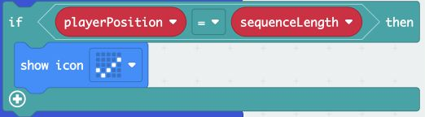
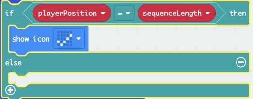

## Check one tap at a time

Finish checking each tap before accepting the next one.

> [!TASK]
>
> Add the following block at the start of the outer condition to stop more taps counting while the current tap is being checked.
>
> ```microbit
> let rebootSequence: number[] = null
> function checkAnswer (answer: number) {
>     if (acceptingInput) {
>         // @highlight
>         acceptingInput = false
>         basic.showNumber(answer)
>         basic.pause(150)
>         basic.clearScreen()
>         if (answer == rebootSequence[playerPosition]) {
>             playerPosition += 1
>             if (playerPosition == sequenceLength) {
>                 basic.showIcon(IconNames.Yes)
>             }
>         } else {
>             basic.showIcon(IconNames.No)
>         }
>     }
> }
> ```

> [!TASK]
>
> Click **+** on the condition that checks whether the code is complete. This adds an empty `else`{:class='microbitlogic'} branch for when there are still numbers left.
>
> {:width="450px"}
>
> {:width="450px"}

> [!TASK]
>
> Add the following block in that new branch to accept the next tap after a correct answer.
>
> ```microbit
> let rebootSequence: number[] = null
> function checkAnswer (answer: number) {
>     if (acceptingInput) {
>         acceptingInput = false
>         basic.showNumber(answer)
>         basic.pause(150)
>         basic.clearScreen()
>         if (answer == rebootSequence[playerPosition]) {
>             playerPosition += 1
>             if (playerPosition == sequenceLength) {
>                 basic.showIcon(IconNames.Yes)
>             } else {
>                 // @highlight
>                 acceptingInput = true
>             }
>         } else {
>             basic.showIcon(IconNames.No)
>         }
>     }
> }
> ```

**Test**

Download your program.

- Enter a code, waiting for each number to disappear before your next tap.
- After the tick, tap again. Nothing should change.
- Press A for a new code and enter a wrong number. The cross should stay until you press A.
