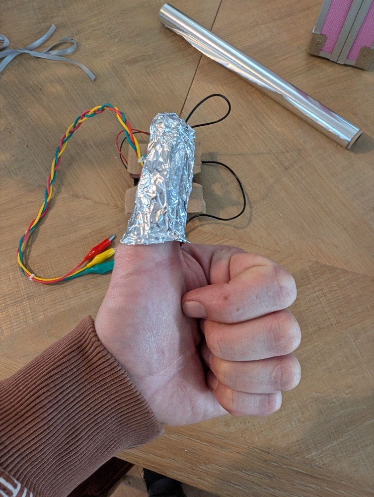
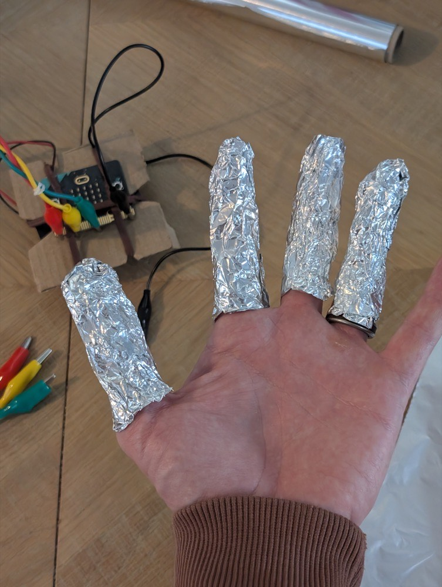
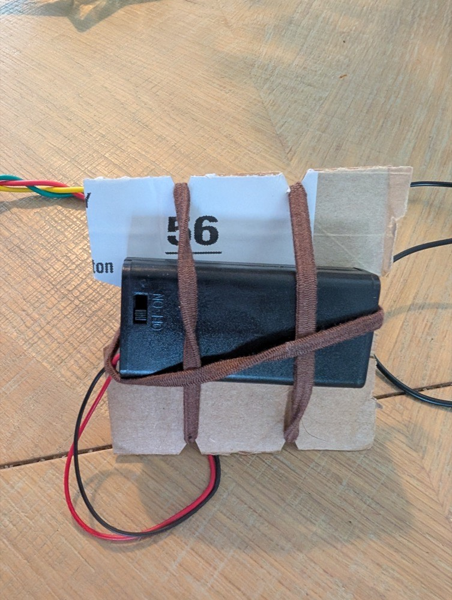
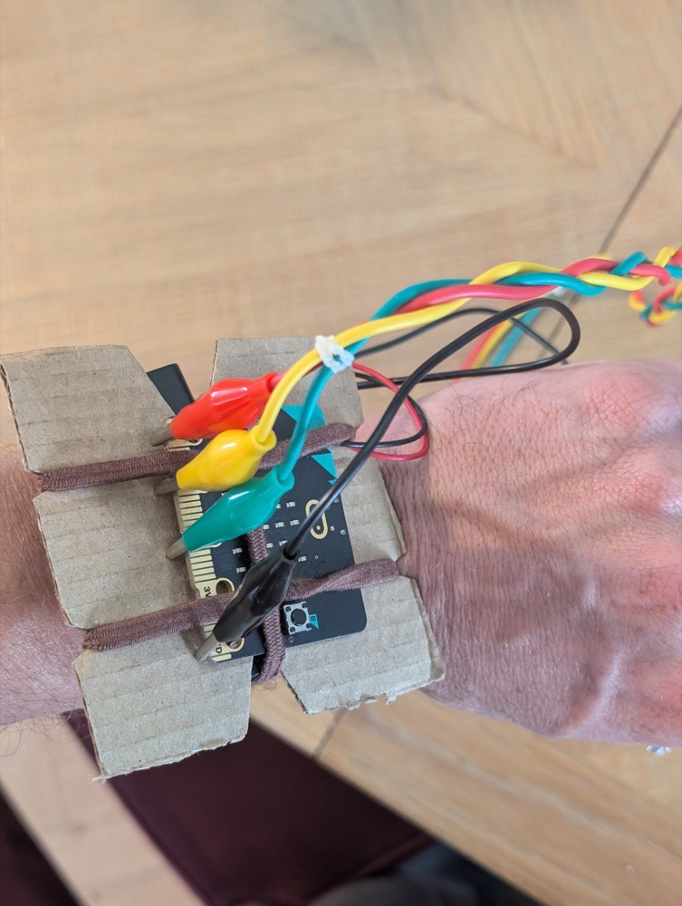

## Build the wearable controls

Your game works with bare leads. Now turn them into finger controls.

> [!TASK]
>
> Tear off four small pieces of kitchen foil. You need one for your thumb and one for each of your index, middle and ring fingers.

> [!TASK]
>
> Wrap one piece loosely around your thumb, leaving foil near its base for a clip to grip.
>
> {:width="300px"}

> [!TASK]
>
> Make a separate contact for each of the other three fingers. Stop each wrap before the knuckle where the finger joins your hand so the pieces do not connect.
>
> {:width="450px"}

> [!TASK]
>
> Cut a piece of thin card a little larger than the micro:bit.

> [!TASK]
>
> Snip small notches into the edges where the elastic bands will sit. This stops them sliding off.

> [!TASK]
>
> Use elastic bands to hold the micro:bit against one side of the card.

> [!TASK]
>
> Use elastic bands to hold the battery pack against the other side.
>
> {:width="450px"}

> [!TASK]
>
> Use another elastic band to hold the controller comfortably on your wrist. Keep the display, buttons and pin rings within reach.
>
> {:width="450px"}

> [!INFO]
>
> Keep all foil contacts and wrist fastenings loose enough to remove straight away. If anything feels tight, take it off and loosen it before playing.

**Test**

Relax your hand. The foil pieces should stay separate. Hold your arm in a playing position for 30 seconds. The controller should stay in place.
