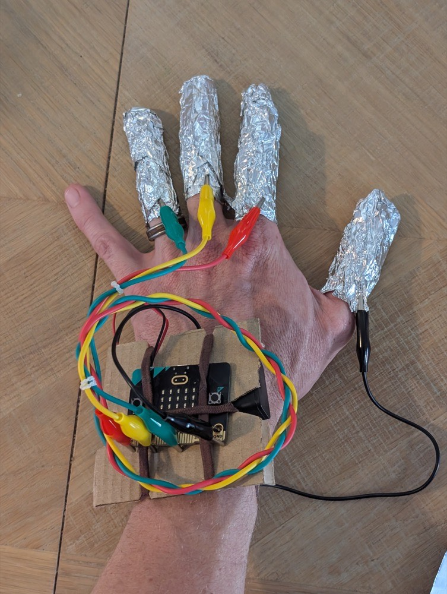
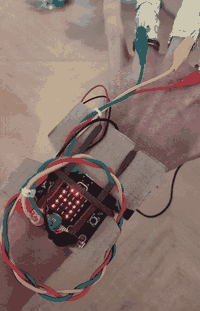

## Connect and play

Attach the tested leads to your finger controls and play your game.

> [!TASK]
>
> Disconnect the USB cable and battery pack.

> [!TASK]
>
> Connect the leads to the foil near the base of each finger.
>
> - GND goes to your thumb.
> - P0 goes to your index finger.
> - P1 goes to your middle finger.
> - P2 goes to your ring finger.
>
> {:width="450px"}

> [!TASK]
>
> Connect the battery pack and press A.

> [!TASK]
>
> Watch the code, then tap the matching fingers against your thumb. Separate the contacts after every tap. Wait for each number to disappear before the next tap.
>
> {:width="450px"}

**Test**

Play several codes until you have used every finger.

- Each tap should show the matching number.
- A mistake should play your warning sound and let you retry.
- Completing your chosen code length should play your winning sound and finish the reboot.

> [!SAVE]
