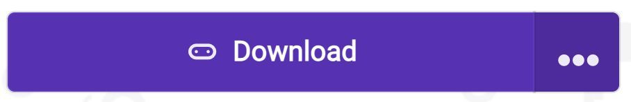
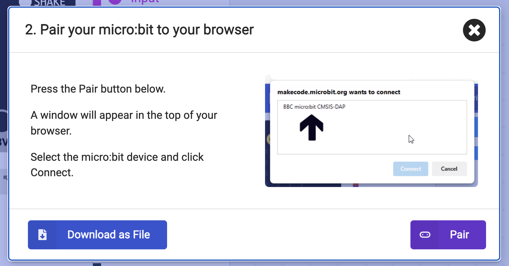
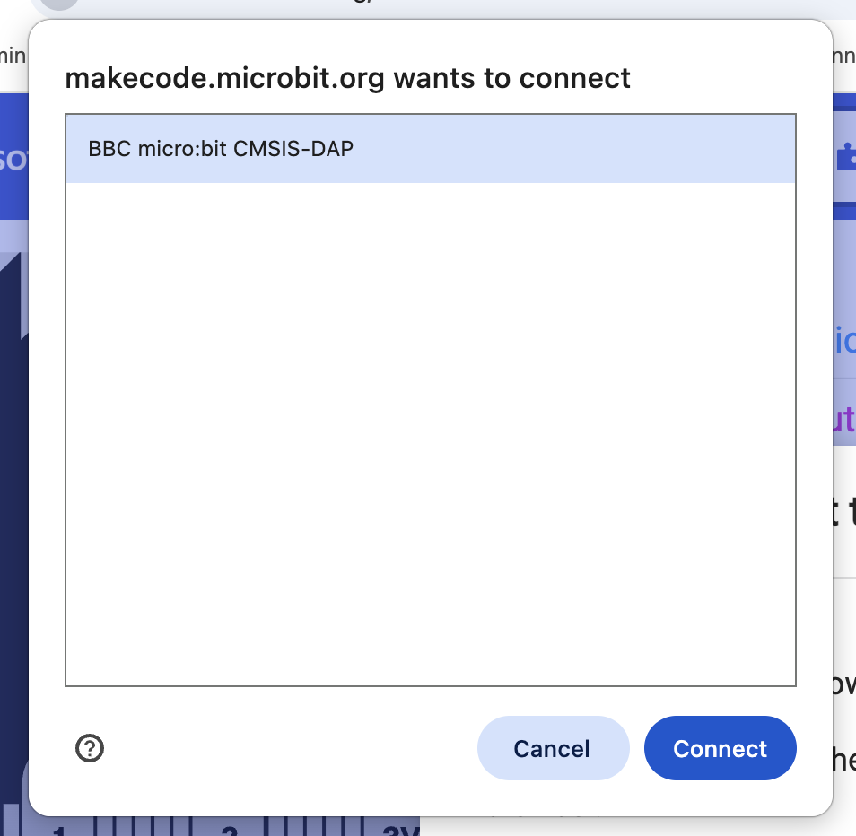

## Start the controller

Make a start screen and send it to your micro:bit.

> [!TASK]
>
> Open [Microsoft MakeCode for micro:bit](https://makecode.microbit.org/){:target="_blank"} and create a project called **Reboot Sequence**.

> [!TASK]
>
> Add the following block from `Basic`{:class='microbitbasic'} inside `on start`{:class='microbitbasic'} to show A when the micro:bit starts. This will help you check that your program transferred successfully. Later, A will remind you which button starts a game.
>
> ```microbit
> basic.showString("A")
> ```

> [!TASK]
>
> Connect your micro:bit to your computer with a USB data cable.
>
> {:width="450px"}

> [!TASK]
>
> Click **Download** to send your program to the micro:bit.
>
> {:width="300px"}

If this is your first download, follow the connection prompts below. If A already appears on your micro:bit, move to the test.

> [!TASK]
>
> Choose **Connect to computer**, then **Next**.
>
> {:width="450px"}

> [!TASK]
>
> Choose **Pair**.
>
> {:width="450px"}

> [!TASK]
>
> Select your micro:bit in the device list, then choose **Connect**.
>
> {:width="450px"}

> [!TASK]
>
> Choose **Download** to finish transferring the program.
>
> {:width="450px"}

> [!TIP]
>
> Pairing works in Chrome and Edge. If your browser saves a HEX file instead, copy it onto the **MICROBIT** drive. See the [micro:bit transfer guide](https://microbit.org/get-started/user-guide/transfer-code-to-the-microbit/){:target="_blank"} for help.

**Test**

Press the reset button on the back of the micro:bit. A should appear on its display.
