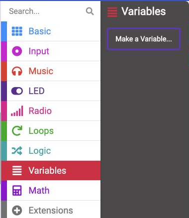
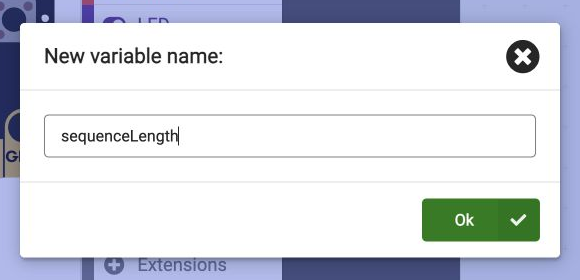

## Choose your code length

You decide how many numbers you want to remember.

> [!TASK]
>
> Open `Variables`{:class='microbitvariables'} and click **Make a Variable...**.
>
> {:width="350px"}

> [!TASK]
>
> Name the variable **sequenceLength**, then click **Ok**. It will store how many numbers are in your code.
>
> {:width="450px"}

> [!TASK]
>
> Add the following block inside `on start`{:class='microbitbasic'} to choose your code length.
>
> ```microbit
> let sequenceLength = 5
> ```

> [!TASK]
>
> Choose a length you want to try. You can use any whole number greater than 0 instead of 5. Try 3 for a shorter code or 8 for a longer challenge.

**Check**

Your start blocks should set your chosen length and show A. The next step will use that length.
