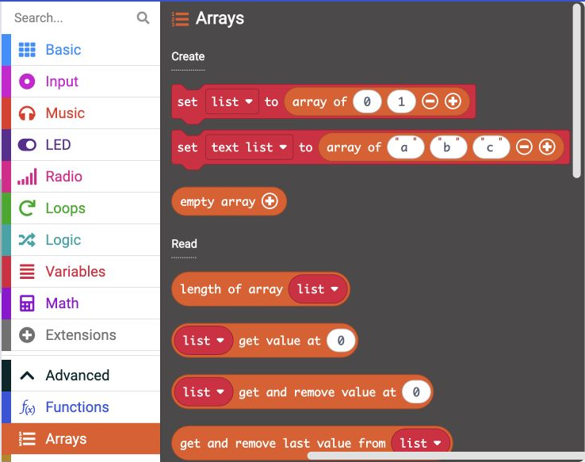
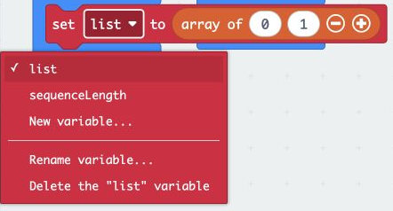
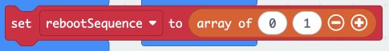

## Generate a reboot code

Store random numbers in a list, ready to play back. The list will use the code length you chose.

> [!TASK]
>
> Open **Advanced**, then `Arrays`{:class='microbitarrays'}. MakeCode calls lists **arrays**.
>
> {:width="450px"}

> [!TASK]
>
> From this menu, add `set list to`{:class='microbitvariables'} with its number array at the top of the button A event. It will store the reboot code.
>
> ```microbit
> let list: number[] = null
> input.onButtonPressed(Button.A, function () {
>     list = [0, 1]
>     basic.showNumber(randint(1, 3))
>     basic.pause(500)
>     basic.clearScreen()
>     basic.pause(200)
> })
> ```

> [!TASK]
>
> Open the list name menu, choose **Rename variable...**, and name it **rebootSequence**.
>
> {:width="450px"}

> [!TASK]
>
> Click **−** on the array until it says `empty array`{:class='microbitarrays'}. This clears the previous code at the start of each game.
>
> {:width="450px"}

> [!TASK]
>
> Add a `repeat`{:class='microbitloops'} block from `Loops`{:class='microbitloops'} below the empty list. It will repeat the blocks you put inside.
>
> ```microbit
> let rebootSequence: number[] = null
> input.onButtonPressed(Button.A, function () {
>     rebootSequence = []
>     for (let count = 0; count < 4; count++) {
>     }
>     basic.showNumber(randint(1, 3))
>     basic.pause(500)
>     basic.clearScreen()
>     basic.pause(200)
> })
> ```

> [!TASK]
>
> Replace the repeat count with `sequenceLength`{:class='microbitvariables'} from `Variables`{:class='microbitvariables'} so the loop uses your chosen code length.
>
> ```microbit
> let rebootSequence: number[] = null
> input.onButtonPressed(Button.A, function () {
>     rebootSequence = []
>     for (let count = 0; count < sequenceLength; count++) {
>     }
>     basic.showNumber(randint(1, 3))
>     basic.pause(500)
>     basic.clearScreen()
>     basic.pause(200)
> })
> ```

> [!TASK]
>
> Add `list add value to end`{:class='microbitarrays'} from `Arrays`{:class='microbitarrays'} inside the loop. This will put one number at the end of the list each time.

> [!TASK]
>
> Choose **rebootSequence** in that block’s list menu.

> [!TASK]
>
> Move the random number block from the display into the add-value block. The loop now fills your list with random numbers.
>
> ```microbit
> let rebootSequence: number[] = null
> input.onButtonPressed(Button.A, function () {
>     rebootSequence = []
>     for (let count = 0; count < sequenceLength; count++) {
>         rebootSequence.push(randint(1, 3))
>     }
>     basic.showNumber(0)
>     basic.pause(500)
>     basic.clearScreen()
>     basic.pause(200)
> })
> ```

**Check**

The empty-list block should be above the repeat loop. The random number block should be inside the loop. The display still shows 0 for now. You will play the saved numbers next.

> [!TIP]
>
> - A list keeps several numbers in order.
> - The repeat loop adds one number each time.
> - Change your code length in the start blocks whenever you want a different challenge.
