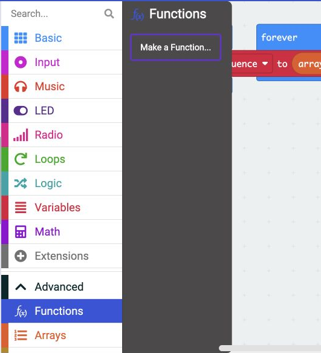
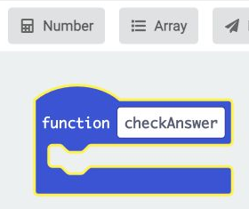
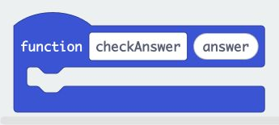

## Make an answer-checking function

A function is a named group of blocks you can use from several places.

> [!TASK]
>
> Use **Make a Variable...** in `Variables`{:class='microbitvariables'} to create **playerPosition**. It will remember which number you need to match next.
>
> {:width="350px"}

> [!TASK]
>
> Open **Advanced**, then `Functions`{:class='microbitfunctions'}, and click **Make a Function...**.
>
> {:width="450px"}

> [!TASK]
>
> Name your function **checkAnswer**. It will check a number from any of the three pin leads.
>
> {:width="300px"}

> [!TASK]
>
> Click **Number** to add a number parameter. A parameter is a value you pass into a function.

> [!TASK]
>
> Name the parameter **answer**, then click **Done**.
>
> {:width="350px"}

**Check**

You should have an empty function with an answer bubble. Next you will add its checking blocks.
